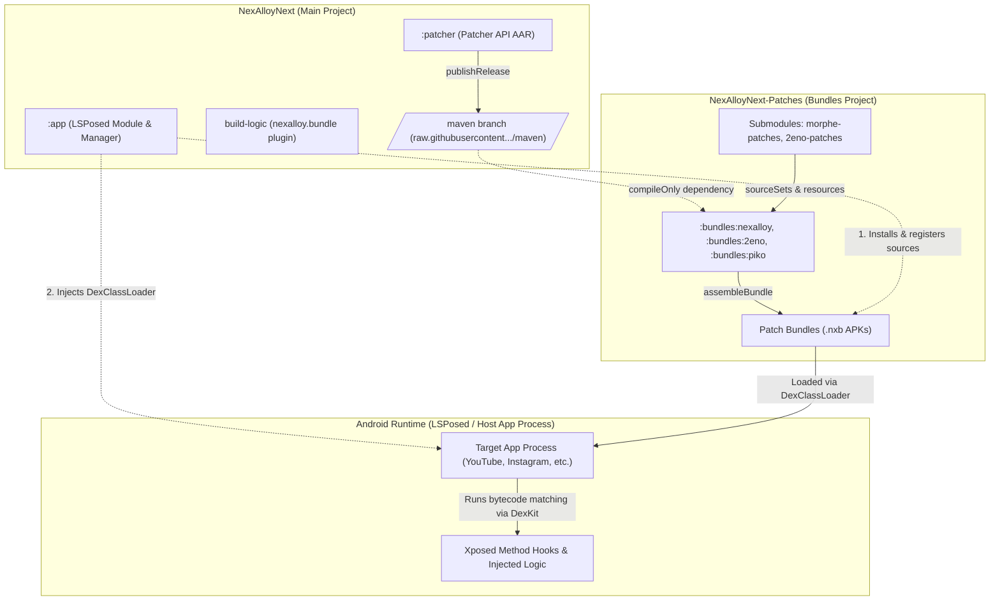

# NexAlloy Repository Audit & Morphe Patch Maintenance Report

**Date:** 2026-10-15  
**Workspace:** `C:\Users\arsal\Desktop\code\NexAlloy`  
**Inspected Repositories:**
- Main Project: `C:\Users\arsal\Desktop\code\NexAlloy\NexAlloyNext`
- Patch Project: `C:\Users\arsal\Desktop\code\NexAlloy\NexAlloyNext-Patches`

---

## A. Repository State

### 1. Main Project (`NexAlloyNext`)
- **Directory:** `C:\Users\arsal\Desktop\code\NexAlloy\NexAlloyNext`
- **Current Branch:** `ccr-6fc3fc93-7lpmys`
- **HEAD Commit:** `db1481d` ("Pull to refresh on Home and Patches instead of a refresh button")
- **Working Tree:** Clean (no uncommitted changes or untracked files)
- **Git Remotes:** None configured (`git remote -v` returns empty; upstream remote removed per design)
- **Submodules:** None configured (no `.gitmodules` file present)
- **Root Files & Structure:**
  - `app/`: LSPosed module APK and manager UI (Jetpack Compose)
  - `patcher/`: Patcher API library (`io.github.nexalloy:patcher`)
  - `build-logic/`: Gradle plugin `nexalloy.bundle` for compiling patch bundles
  - `template/`: Standalone bundle template for external patch authors
  - `gradle/`, `gradlew`, `gradlew.bat`, `gradle.properties`, `settings.gradle.kts`, `build.gradle.kts`
  - `DEVELOPMENT.md`, `README.md`, `LICENSE`

### 2. Patch Project (`NexAlloyNext-Patches`)
- **Directory:** `C:\Users\arsal\Desktop\code\NexAlloy\NexAlloyNext-Patches`
- **Current Branch:** `main`
- **HEAD Commit:** `abde111` ("Stealth follow: show the button only for public, not-yet-followed accounts (#14)")
- **Working Tree:** Clean (no uncommitted changes or untracked files)
- **Git Remotes:** None configured (`git remote -v` returns empty; upstream remote removed per design)
- **Submodules Configuration (`.gitmodules`):**
  - `morphe-patches`:
    - Path: `morphe-patches`
    - Upstream URL: `https://github.com/NexAlloy/morphe-patches`
    - Tracked Branch: `nexalloy`
    - Pinned Git SHA: `477fbc0f5f3bb5189fd45ace429b60f7fe4c3b15`
    - Current State: Uninitialized / not cloned locally (`-` prefix in `git submodule status`)
  - `morphe-patches-library`:
    - Path: `morphe-patches-library`
    - Upstream URL: `https://github.com/NexAlloy/morphe-patches-library`
    - Tracked Branch: `nexalloy`
    - Pinned Git SHA: `d546363d4cf3a5b98dfb7f9ea5dc92e9c1d72e0e`
    - Current State: Uninitialized / not cloned locally (`-` prefix in `git submodule status`)
  - `2eno-patches`:
    - Path: `2eno-patches`
    - Upstream URL: `https://github.com/2eno/2eno-patches`
    - Tracked Branch: `main`
    - Pinned Git SHA: `88053fdd793cbedf7c660f6cf0e0b3e4ca2941a2`
    - Current State: Uninitialized / not cloned locally (`-` prefix in `git submodule status`)
- **Root Files & Structure:**
  - `bundles/`:
    - `nexalloy/`: Morphe, ReVanced, and hoodles patches
    - `piko/`: Instagram and X patches ported from Piko
    - `2eno/`: Spotify, Kleinanzeigen, Untappd, Instagram stealth follow, and InterPals patches
    - `testing/`: Shared JUnit 5 / DexKit fingerprint test harness
  - `stub/`: Stubs of YouTube classes used by Morphe extensions
  - `build-logic/`: Copy of `nexalloy.bundle` Gradle plugin
  - `gradle/`, `gradlew`, `gradlew.bat`, `gradle.properties`, `settings.gradle.kts`, `build.gradle.kts`
  - `DEVELOPMENT.md`, `README.md`, `LICENSE`

---

## B. Architecture

### 1. What the Main Project Builds
- **`:app` (NexAlloyNext APK):** An Android application acting as both an LSPosed module and a manager UI built in Jetpack Compose. It manages patch sources, downloads and caches patch bundles (`.nxb`), requests app scopes from LSPosed, and injects patch bundles into target applications at launch using `DexClassLoader` and `XposedDexRemapper`.
- **`:patcher` (`io.github.nexalloy:patcher` AAR):** The core patcher API that bundles compile against. It encapsulates:
  - `Patch`, `PatchExecutor`, `PatchBundle`, and `AppPatchInfo` abstractions ([`PatchBundle.kt`](file:///C:/Users/arsal/Desktop/code/NexAlloy/NexAlloyNext/patcher/src/main/java/io/github/nexalloy/PatchBundle.kt)).
  - DexKit integration bridge with caching (`DexKitCacheBridge.RecyclableBridge`).
  - Xposed hook helpers and scoped hooks ([`Helper.kt`](file:///C:/Users/arsal/Desktop/code/NexAlloy/NexAlloyNext/patcher/src/main/java/io/github/nexalloy/Helper.kt)).
  - ClassLoader injection helpers (`injectSelfClassLoaderToHost`, `injectHostClassLoaderToSelf`).
  - Morphe compatibility DSL translating ReVanced/Morphe fingerprint queries to DexKit matchers ([`FingerprintCompat.kt`](file:///C:/Users/arsal/Desktop/code/NexAlloy/NexAlloyNext/patcher/src/main/java/io/github/nexalloy/morphe/FingerprintCompat.kt)).

### 2. What the Patches Project Builds
- Patch bundles (`.nxb` files): Android APKs compiled using the custom `nexalloy.bundle` Gradle plugin.
- Three bundles are defined in [`settings.gradle.kts`](file:///C:/Users/arsal/Desktop/code/NexAlloy/NexAlloyNext-Patches/settings.gradle.kts):
  1. `:bundles:nexalloy` (`nexalloy-1.0.<versionCode>.nxb`)
  2. `:bundles:2eno` (`2eno-<patchesVersion>-<bundleRevision>.nxb`)
  3. `:bundles:piko` (`piko-1.1.7.nxb`)

### 3. Morphe Implementation and Integration
- **Role of Morphe:** Morphe's patch architecture (originally designed for APK rewriting/smali patching) is adapted to run dynamically at runtime inside the target app's memory space via Xposed and DexKit.
- **Fingerprint Compatibility Layer:** [`FingerprintCompat.kt`](file:///C:/Users/arsal/Desktop/code/NexAlloy/NexAlloyNext/patcher/src/main/java/io/github/nexalloy/morphe/FingerprintCompat.kt) bridges ReVanced/Morphe concepts (`Fingerprint`, `InstructionFilter`, `Opcode`, `accessFlags`, `strings`, `literal`) to DexKit's native search queries (`DexKitBridge`, `MethodMatcher`, `ClassMatcher`).
- **Submodule Extensions:** Rather than rewriting Morphe patches from scratch, the `nexalloy` and `2eno` bundles incorporate Java extensions and protobuf declarations directly from the Morphe submodule tree:
  - `../../morphe-patches/extensions/shared/library/src/main/java`
  - `../../morphe-patches/extensions/shared-youtube/library/src/main/java`
  - `../../morphe-patches/extensions/youtube/src/main/java`
  - `../../morphe-patches/extensions/music/src/main/java`
  - `../../morphe-patches/extensions/reddit/src/main/java`
  - `../../morphe-patches-library/extension-library/src/main/java`
  - `../../2eno-patches/extensions/twoeno/src/main/java`
- **Dynamic Resource Generation:** Gradle tasks `GenerateMorpheTargetsTask`, `GenerateStringsTask`, and `CopyResourcesTask` in [`bundles/nexalloy/build.gradle.kts`](file:///C:/Users/arsal/Desktop/code/NexAlloy/NexAlloyNext-Patches/bundles/nexalloy/build.gradle.kts#L98-L266) read XML strings, arrays, drawables, and target constants directly from the `morphe-patches` submodule.

### 4. Integration Mechanism Between Projects
- **Build-Time Integration:**
  - The patches project declares `compileOnly(libs.nexalloy.patcher)` in each bundle's build script.
  - The repository URL is configured via `nexalloyMaven` in `gradle.properties` (`https://raw.githubusercontent.com/2eno/NexAlloyNext/maven`).
  - When building locally against a fresh patcher change, the main project publishes via `./gradlew :patcher:publishAllPublicationsToReleaseRepository` and the patches project consumes it via `-PnexalloyMaven=file:///path/to/NexAlloyNext/build/maven`.
- **Runtime Integration:**
  - The main application (`NexAlloyNext`) connects to GitHub releases or JSON manifests (`patches-bundle.json`) to download `.nxb` bundles.
  - At runtime, `MainHook.kt` creates a `DexClassLoader` targeting the `.nxb` APK file, with the module's ClassLoader as the parent. The module provides DexKit, Xposed APIs, and Kotlin stdlib.
  - `PatchSession` invokes the bundle entry point (implementing `PatchBundle`), checks per-patch preferences, executes matched fingerprints, and hooks target methods.

---

## C. Patch Inventory

### Bundle 1: `nexalloy` (`io.github.nexalloy.patches.NexAlloyPatches`)
*Resource Package ID:* `0x4b` | *Version Code:* `5` | *Version Name:* `1.0.5`

| Application | Package ID | Declared / Recommended Targets | Patches Discovered | Implementation Entry / Files |
|---|---|---|---|---|
| **YouTube** | `com.google.android.youtube` | `MorpheTargets.YOUTUBE` (derived from `morphe-patches` submodule; version checks up to `21.39.000`) | 25 patches: `ExtensionHook`, `BackgroundPlayback`, `SanitizeSharingLinks`, `HideAds`, `SponsorBlock`, `CopyVideoLinkButtonPatch`, `Downloads`, `HideShortsComponents`, `DisableShortsResumingOnStartup`, `NavigationBar`, `SwipeControls`, `VideoQuality`, `HideLayoutComponents`, `HideVideoActionButtons`, `PlaybackSpeed`, `AutoCaptions`, `EnableDebugging`, `ForceOriginalAudio`, `DisableVideoCodecs`, `deArrowPatch`, `BypassImageRegionRestrictionsPatch`, `CheckRecycleBitmapMediaSession`, `changeStartPagePatch`, `SettingsHook`, `FeatureOverride` | [`YoutubeHook.kt`](file:///C:/Users/arsal/Desktop/code/NexAlloy/NexAlloyNext-Patches/bundles/nexalloy/src/main/java/io/github/nexalloy/morphe/youtube/YoutubeHook.kt) |
| **YT Music** | `com.google.android.apps.youtube.music` | `MorpheTargets.MUSIC` (derived from `morphe-patches` submodule; version checks up to `9.33.00`) | 9 patches: `ExtensionResourceHook`, `BackgroundPlayback`, `HideUpgradeButton`, `HideAds`, `EnableExclusiveAudioPlayback`, `CheckRecycleBitmapMediaSession`, `EnableDebugging`, `SanitizeSharingLinks`, `SettingsHook` | [`MusicHook.kt`](file:///C:/Users/arsal/Desktop/code/NexAlloy/NexAlloyNext-Patches/bundles/nexalloy/src/main/java/io/github/nexalloy/morphe/music/MusicHook.kt) |
| **Reddit** | `com.reddit.frontpage` | `MorpheTargets.REDDIT` (derived from `morphe-patches` submodule; version checks up to `2026.18.0`) | 3 patches: `HideAds` (promoted posts, ad sections, comment ads, placeholder state), `SanitizeSharingLinks`, `startAsGuestPatch` | [`RedditHook.kt`](file:///C:/Users/arsal/Desktop/code/NexAlloy/NexAlloyNext-Patches/bundles/nexalloy/src/main/java/io/github/nexalloy/morphe/reddit/RedditHook.kt) |
| **Google Photos** | `com.google.android.apps.photos` | Any (empty target list) | 2 patches: `SpoofFeaturesPatch` (Pixel XL feature spoofing), `EnableDCIMFoldersBackupControl` | [`GooglePhotosHook.kt`](file:///C:/Users/arsal/Desktop/code/NexAlloy/NexAlloyNext-Patches/bundles/nexalloy/src/main/java/io/github/nexalloy/revanced/googlephotos/GooglePhotosHook.kt) |
| **Photomath** | `com.microblink.photomath` | Any (empty target list) | 1 patch: `UnlockPlus` | [`PhotomathHook.kt`](file:///C:/Users/arsal/Desktop/code/NexAlloy/NexAlloyNext-Patches/bundles/nexalloy/src/main/java/io/github/nexalloy/revanced/photomath/PhotomathHook.kt) |
| **Threads** | `com.instagram.barcelona` | Any (empty target list) | 1 patch: `HideAds` | [`MetaHook.kt`](file:///C:/Users/arsal/Desktop/code/NexAlloy/NexAlloyNext-Patches/bundles/nexalloy/src/main/java/io/github/nexalloy/revanced/meta/MetaHook.kt) |
| **Strava** | `com.strava` | Any (empty target list) | 2 patches: `UnlockSubscription`, `DisableSubscriptionSuggestions` | [`StravaHook.kt`](file:///C:/Users/arsal/Desktop/code/NexAlloy/NexAlloyNext-Patches/bundles/nexalloy/src/main/java/io/github/nexalloy/revanced/strava/StravaHook.kt) |
| **AllTrails** | `com.alltrails.alltrails` | Any (empty target list) | 1 patch: `EnablePeakMembership` | [`AllTrailsHook.kt`](file:///C:/Users/arsal/Desktop/code/NexAlloy/NexAlloyNext-Patches/bundles/nexalloy/src/main/java/io/github/nexalloy/hoodles/morphe/alltrails/AllTrailsHook.kt) |

---

### Bundle 2: `piko` (`io.github.nexalloy.piko.PikoPatches`)
*Resource Package ID:* `0x4d` | *Version Code:* `12` | *Version Name:* `1.1.7`

| Application | Package ID | Declared / Recommended Targets | Patches Discovered | Implementation Entry / Files |
|---|---|---|---|---|
| **Instagram** | `com.instagram.android` | `447.0.0.55.81` | 31 patches: `HideAds`, `HideSuggestedContent`, `UnlockPlusBenefits`, `DownloadMedia`, `DisableAnalytics`, `DisableStories`, `DisableHighlights`, `DisableExplore`, `DisableComments`, `DisableDiscoverPeople`, `ViewStoriesAnonymously`, `ViewLiveAnonymously`, `ViewDmsAnonymously`, `DisableTypingStatus`, `DisableScreenshotDetection`, `SanitizeShareLinks`, `OpenLinksExternally`, `HideReshareButton`, `HideReelsButton`, `HideCreateButton`, `HideSearchButton`, `HideDirectButton`, `HideNotesTray`, `DisableDoubleTapLike`, `DisableReelsScrolling`, `DisableStoryFlipping`, `DisableVideoAutoplay`, `StoriesAudioAutoplay`, `DisableOnboardingPermissionPrompts`, `RemoveBuildExpiredPopup`, `LimitFeedToFollowingProfiles`, `ImproveImageViewing`, `UnlockDeveloperOptions` | [`InstagramHook.kt`](file:///C:/Users/arsal/Desktop/code/NexAlloy/NexAlloyNext-Patches/bundles/piko/src/main/java/io/github/nexalloy/piko/instagram/InstagramHook.kt) |
| **X (Twitter)** | `com.twitter.android` | `12.19.1-release.0` | 19 patches: `HideAds`, `HideRecommendationItems`, `HideTopPeopleInSearch`, `HideRecommendedUsers`, `RemovePremiumUpsell`, `ShowSensitiveMedia`, `HidePromoteButton`, `HideLiveThreads`, `RemoveViewCount`, `HideBookmarkIcon`, `HideImmersivePlayer`, `HideFollowedByContext`, `ClearTrackingParams`, `NoShortenedUrl`, `DisableChirpFont`, `HideFabMenuButtons`, `RestoreLegacyFollowerLists`, `RemoveSearchSuggestions`, `PauseSearchSuggestions` | [`TwitterHook.kt`](file:///C:/Users/arsal/Desktop/code/NexAlloy/NexAlloyNext-Patches/bundles/piko/src/main/java/io/github/nexalloy/piko/twitter/TwitterHook.kt) |

---

### Bundle 3: `2eno` (`io.github.nexalloy.2eno.Patches2eno`)
*Resource Package ID:* `0x4c` | *Bundle Revision:* `8`

| Application | Package ID | Declared / Recommended Targets | Patches Discovered | Implementation Entry / Files |
|---|---|---|---|---|
| **Spotify** | `com.spotify.music` | `9.1.88.2204` | 12 patches: `MuteAudioAds`, `HideAdSections`, `HideAdViews`, `HideContextMenuUpsells`, `BlockPopupAds`, `HidePlaylistAds`, `HideVideoAds`, `HidePremiumTab`, `FixThirdPartyLaunchersWidgets`, `SanitizeSharingLinks`, `MaterialYouTheme`, `RoundedCorners` | [`SpotifyHook.kt`](file:///C:/Users/arsal/Desktop/code/NexAlloy/NexAlloyNext-Patches/bundles/2eno/src/main/java/io/github/nexalloy/2eno/spotify/SpotifyHook.kt) |
| **Kleinanzeigen** | `com.ebay.kleinanzeigen` | `2026.41.0` | 3 patches: `HideAds`, `HidePur`, `SanitizeSharingLinks` | [`KleinanzeigenHook.kt`](file:///C:/Users/arsal/Desktop/code/NexAlloy/NexAlloyNext-Patches/bundles/2eno/src/main/java/io/github/nexalloy/2eno/kleinanzeigen/KleinanzeigenHook.kt) |
| **Untappd** | `com.untappdllc.app` | Any (empty target list) | 3 patches: `HideReactNativeAds`, `HideFeedAds`, `HideSponsoredContent` | [`UntappdHook.kt`](file:///C:/Users/arsal/Desktop/code/NexAlloy/NexAlloyNext-Patches/bundles/2eno/src/main/java/io/github/nexalloy/2eno/untappd/UntappdHook.kt) |
| **Instagram** | `com.instagram.android` | `447.0.0.55.81` | 1 patch: `StealthFollow` (shows stealth follow button only for public, not-yet-followed accounts) | [`InstagramHook.kt`](file:///C:/Users/arsal/Desktop/code/NexAlloy/NexAlloyNext-Patches/bundles/2eno/src/main/java/io/github/nexalloy/2eno/instagram/InstagramHook.kt) |
| **InterPals** | `net.interpals` | `2.16.1` | 4 patches: `HideReactNativeAds`, `DisableAdPlacements`, `DownloadPhotos`, `FeedFilter` | [`InterPalsHook.kt`](file:///C:/Users/arsal/Desktop/code/NexAlloy/NexAlloyNext-Patches/bundles/2eno/src/main/java/io/github/nexalloy/2eno/interpals/InterPalsHook.kt) |

---

## D. Compatibility Findings

### 1. Fragile Version String Comparisons (Suspected Incompatibility)
- **Location:**
  - YouTube: [`VersionCheckPatch.kt`](file:///C:/Users/arsal/Desktop/code/NexAlloy/NexAlloyNext-Patches/bundles/nexalloy/src/main/java/io/github/nexalloy/morphe/youtube/misc/playservice/VersionCheckPatch.kt#L109) (`fun isEqualsOrGreaterThan(version: String) = versionName >= version`)
  - YT Music: [`VersionCheckPatch.kt`](file:///C:/Users/arsal/Desktop/code/NexAlloy/NexAlloyNext-Patches/bundles/nexalloy/src/main/java/io/github/nexalloy/morphe/music/misc/playservice/VersionCheckPatch.kt#L30-L32)
  - Reddit: [`VersionCheckPatch.kt`](file:///C:/Users/arsal/Desktop/code/NexAlloy/NexAlloyNext-Patches/bundles/nexalloy/src/main/java/io/github/nexalloy/morphe/reddit/misc/version/VersionCheckPatch.kt#L23-L25)
- **Issue:** Versions are compared using raw string comparison (`versionName >= version`).
  - Standard lexicographical comparison produces erroneous results when digit counts differ (e.g. `"2026.4.0" > "2026.16.0"` because `'4' > '1'`, or `"21.9.0" > "21.39.0"`).
  - While `AppVersion` in [`UnitTestAnnotations.kt`](file:///C:/Users/arsal/Desktop/code/NexAlloy/NexAlloyNext/patcher/src/main/java/io/github/nexalloy/UnitTestAnnotations.kt#L11-L39) properly splits numeric segments for unit test evaluation, runtime version checking uses raw string operators.

### 2. Reddit Version Constraints and Fingerprint Obsolescence (Confirmed Incompatibility)
- **Location:** [`bundles/nexalloy/src/main/java/io/github/nexalloy/morphe/reddit/ad/Fingerprints.kt`](file:///C:/Users/arsal/Desktop/code/NexAlloy/NexAlloyNext-Patches/bundles/nexalloy/src/main/java/io/github/nexalloy/morphe/reddit/ad/Fingerprints.kt#L34)
- **Evidence:**
  - `SubmittedListingFingerprint` is constrained by `@RequireAppVersion(maxVersion = "2026.16.0")` with comment: *"Class appears to be removed in 2026.16.0+"*.
  - `CommentsAdStateToStringFingerprint` is gated to `@RequireAppVersion("2026.04.0")`.
  - The runtime check `VersionCheckPatch.kt` only tracks flags up to `is_2026_18_0_or_greater`.
  - Reddit versions beyond `2026.18.0` lack dedicated fingerprint adaptations.

### 3. YouTube Fingerprint Drift and Version Branching (Confirmed)
- **Location:**
  - [`layout/shortsnoresume/Fingerprints.kt`](file:///C:/Users/arsal/Desktop/code/NexAlloy/NexAlloyNext-Patches/bundles/nexalloy/src/main/java/io/github/nexalloy/morphe/youtube/layout/shortsnoresume/Fingerprints.kt#L14-L67): Fingerprints are fragmented across versions: `20.02 - 21.03`, `21.03 - 21.29`, and `21.30+`.
  - [`misc/contexthook/Fingerprints.kt`](file:///C:/Users/arsal/Desktop/code/NexAlloy/NexAlloyNext-Patches/bundles/nexalloy/src/main/java/io/github/nexalloy/morphe/youtube/misc/contexthook/Fingerprints.kt#L96-L117): `messageLiteBuilderMethodLegacy` is capped at `maxVersion = "21.33.000"`, and `messageLiteBuilderMethod` is required for `21.33.000+`. `ReelCreateItemsEndpointConstructorFingerprint` is capped at `maxVersion = "21.21.00"`.
  - [`misc/playercontrols/LegacyPlayerControlsPatch.kt`](file:///C:/Users/arsal/Desktop/code/NexAlloy/NexAlloyNext-Patches/bundles/nexalloy/src/main/java/io/github/nexalloy/morphe/youtube/misc/playercontrols/LegacyPlayerControlsPatch.kt#L125): `is_21_36_or_greater` forces `disableNewPlayerControlsFeatureFlag()`.
  - Highest version checked in `VersionCheckPatch.kt` is `21.39.000`. Supporting YouTube versions newer than `21.39` requires testing whether obfuscated instruction offsets and Litho/Protobuf layouts have shifted.

### 4. Instagram Stealth Follow and Download Hook Instability (Ongoing Maintenance)
- **Location:**
  - [`bundles/2eno/src/main/java/io/github/nexalloy/2eno/instagram/stealth/StealthFollow.kt`](file:///C:/Users/arsal/Desktop/code/NexAlloy/NexAlloyNext-Patches/bundles/2eno/src/main/java/io/github/nexalloy/2eno/instagram/stealth/StealthFollow.kt)
  - [`bundles/piko/src/main/java/io/github/nexalloy/piko/instagram/download/MediaExtractor.kt`](file:///C:/Users/arsal/Desktop/code/NexAlloy/NexAlloyNext-Patches/bundles/piko/src/main/java/io/github/nexalloy/piko/instagram/download/MediaExtractor.kt)
- **Evidence:** Commits `abde111`, `eda2951`, `d097c51`, `1e32611`, `0881c95`, and `fd8ccc3` represent ongoing bug fixes for profile ID crashes, tap-to-toggle UI, and media extraction. Both bundles pin Instagram target version to `447.0.0.55.81`. Any upgrade to newer Instagram releases must re-verify stealth follow and downloader reflection targets.

### 5. Skipped Unit Tests (`@SkipTest`)
- Several fingerprints in `bundles/nexalloy` are explicitly marked with `@SkipTest`:
  - `FullScreenEngagementAdContainerFingerprint` (`ad/Fingerprints.kt:28`, commented *"/*unused*/"*)
  - `flyout` fingerprints (`layout/flyout/Fingerprints.kt:71, 169, 200`)
  - `clientVersionField` and `clientFormFactorField` (`misc/contexthook/Fingerprints.kt:87, 123`, commented *"/* unused */"*)
  - `litho/rendernext` (`misc/litho/rendernext/Fingerprints.kt:48`)
  - `playerresponse` (`video/playerresponse/Fingerprints.kt:9`)
- These skipped tests represent deprecated or dead code paths that should be either cleaned or updated.

---

## E. Build Requirements

### 1. Environment Specifications (from Codebase Declarations)
- **Java Version:** Java 21 (Temurin recommended). Declared in:
  - `gradle/gradle-daemon-jvm.properties` (`toolchainVersion=21`)
  - `.github/workflows/android.yml` (`java-version: '21'`)
  - `.github/workflows/release.yml` (`java-version: '21'`)
  - Kotlin compilation target: `JvmTarget.JVM_17` / Java 17 compatibility.
- **Gradle Version:** Gradle 9.5.0 (`gradle/wrapper/gradle-wrapper.properties`).
- **Android Gradle Plugin (AGP):** `9.2.1` (`gradle/libs.versions.toml`).
- **Android SDK:**
  - `compileSdk = 37`
  - `minSdk = 27`
- **Build Machine State (Current Local Machine):**
  - Host OS: Windows 11 (64-bit).
  - Java on PATH: Oracle Java `25.0.2+10-LTS-69`.
  - Android SDK (`ANDROID_HOME`): **Not installed / not configured**.
  - Docker / `act`: **Not installed**.

### 2. Submodule Dependencies for Builds
- Building `:bundles:nexalloy`, `:bundles:2eno`, and `:stub` **strictly requires** the three submodules (`morphe-patches`, `morphe-patches-library`, `2eno-patches`) to be initialized and checked out.
- Without submodules:
  - `bundles/nexalloy/build.gradle.kts` fails because `Constants.kt` (for `GenerateMorpheTargetsTask`), XML files (for `GenerateStringsTask` and `CopyResourcesTask`), and extension Java/proto source directories do not exist.
  - `bundles/2eno/build.gradle.kts` fails because `../../2eno-patches/extensions/twoeno/src/main/java` does not exist.
  - `:stub/build.gradle.kts` fails because `../morphe-patches/extensions/.../stub` does not exist.

### 3. Signing Credentials for Release Builds
- Release APKs (`NexAlloyNext`) require GitHub Actions secrets:
  - `KEYSTORE` (base64-encoded JKS)
  - `KEYSTORE_PASSWORD`
  - `KEYSTORE_ALIAS`
  - `KEYSTORE_ALIAS_PASSWORD`
- Pre-releases fall back to a debug signing key if secrets are absent.

### 4. Available Local Validation Commands
- Inspect Gradle wrapper: `.\gradlew --version`
- Local tests (when submodules and SDK are available):
  - In `NexAlloyNext`: `.\gradlew testDebugUnitTest`
  - In `NexAlloyNext-Patches`: `.\gradlew testDebugUnitTest`
- Bundle assembly (in `NexAlloyNext-Patches`): `.\gradlew assembleBundle`

---

## F. CI Analysis

### 1. Main Project Workflows (`NexAlloyNext`)
- **`android.yml` (CI on push to `main` & pull requests):**
  - Sets up JDK 21 (Temurin) with Gradle cache.
  - Decodes `KEYSTORE` if secrets are provided.
  - Executes `./gradlew testDebugUnitTest`.
  - Executes `./gradlew :app:assembleDebug`.
  - If signed, executes `./gradlew :app:assembleRelease` and publishes a GitHub pre-release ("autobuild") tagged with the short commit SHA.
  - Uploads debug APK as artifact `nexalloy-ci-debug-apk`.
- **`release.yml` (Tagged Releases `*.*.*` or Workflow Dispatch):**
  - Requires tag name. Enforces signing secrets for stable releases; allows debug signature for pre-releases.
  - Builds `:app:assembleRelease` and `:patcher:publishAllPublicationsToReleaseRepository`.
  - Creates GitHub release with `NexAlloyNext-<tag>.apk`.
  - **Automated Maven Publication:** Publishes the built patcher API and DexKit AAR to the repository's `maven` branch using git worktree. This enables external patch bundles to consume `io.github.nexalloy:patcher` via GitHub Raw.

### 2. Patches Project Workflows (`NexAlloyNext-Patches`)
- **`android.yml` (CI on push to `main` & pull requests):**
  - Checks out repository with `submodules: true`.
  - Sets up JDK 21 (Temurin).
  - Executes `./gradlew testDebugUnitTest`.
  - Executes `./gradlew assembleBundle`.
  - Uploads generated `.nxb` files as artifact `nexalloy-ci-bundles`.
- **`release.yml` (Tagged Releases `*.*.*` or Workflow Dispatch):**
  - Checks out with `submodules: true`.
  - Executes `./gradlew assembleBundle`.
  - Creates GitHub release containing all `.nxb` bundles (`bundles/*/build/outputs/bundle/*.nxb`).
  - Cleans up older matching releases if `delete` parameter is passed.

### 3. CI Deficiencies & Recommended Improvements
1. **Patcher API Coupling to Upstream Maven:**
   - In `gradle.properties`: `nexalloyMaven=https://raw.githubusercontent.com/2eno/NexAlloyNext/maven`.
   - When developing locally or in a private fork, CI in `NexAlloyNext-Patches` will pull the upstream `2eno` maven branch rather than the fork's own patcher API unless `nexalloyMaven` is explicitly pointed to the fork or supplied via workflow inputs/secrets.
2. **Submodule URL Fragility:**
   - `.gitmodules` uses absolute URLs: `https://github.com/NexAlloy/morphe-patches`, `https://github.com/NexAlloy/morphe-patches-library`, `https://github.com/2eno/2eno-patches`.
   - If upstream changes visibility or deletes repositories, checkout fails.
3. **Action Version Drift:**
   - The workflow YAMLs specify `actions/checkout@v6`, `actions/setup-java@v5`, `actions/upload-artifact@v7`. In standard GitHub Actions environments, checkout is v4, setup-java is v4, and upload-artifact is v4. If these future version tags do not exist on the runner, GitHub Actions will fail to resolve the action. Verification against GitHub Actions runner capabilities is recommended before triggering authoritative CI runs.

---

## G. Prioritized Roadmap

### 1. Build and Dependency Problems (Priority 1)
- **Submodule Management:** Establish whether submodule remotes are reachable, and evaluate if submodules should be vendored or pinned to reliable personal forks to ensure deterministic builds in GitHub Actions.
- **Patcher API Distribution:** Clarify the workflow for syncing patcher API changes: ensure that when `NexAlloyNext` publishes to its `maven` branch, `NexAlloyNext-Patches` builds against that branch instead of upstream `2eno`.
- **CI Action Version Verification:** Confirm that the action tags (`actions/checkout@v6`, `setup-java@v5`, `upload-artifact@v7`) resolve on standard GitHub-hosted runners, or align them with known stable tags (`checkout@v4`, `setup-java@v4`, `upload-artifact@v4`).

### 2. Existing Patch Compatibility Fixes (Priority 2)
- **Fix Runtime Version Comparison:** Replace lexicographical string comparison (`versionName >= version`) in `VersionCheckPatch.kt` (YouTube, YT Music, Reddit) with semantic segment-by-segment version comparison (like `AppVersion`).
- **Reddit Ad Patch Adaptation:**
  - Update `VersionCheckPatch.kt` in `reddit` to support versions past `2026.18.0`.
  - Investigate the replacement for `SubmittedListingFingerprint` for Reddit 2026.16.0+ to prevent ad filtering breaks on newer versions.
- **YouTube Version Support:**
  - Audit Litho/Protobuf changes for YouTube 21.40+.
  - Verify whether `messageLiteBuilderMethod` and `shortsnoresume` fingerprints resolve on YouTube 21.40+.
- **Instagram Patches Validation:**
  - Verify stealth follow and downloader compatibility against Instagram builds newer than `447.0.0.55.81`.

### 3. New Patch Development (Priority 3)
- Establish standard contribution pipeline following Phase 6: define application package, create isolated category package under `bundles/<bundle>/src/main/java`, specify minimal DexKit fingerprint, add `AppTarget` metadata, and integrate into entry point array.

### 4. CI Improvements (Priority 4)
- Add workflow dispatch input for `nexalloyMaven` URL in `NexAlloyNext-Patches/.github/workflows/android.yml` to allow testing patch bundles against feature branches of `NexAlloyNext`.
- Add test report publishing step to CI to capture JUnit results.

### 5. Documentation and Regression Testing (Priority 5)
- Document the testing process for placing APKs into `bundles/*/binaries/` and running `./gradlew testDebugUnitTest`.
- Clean up unused `@SkipTest` fingerprints to maintain test harness clarity.

---

## H. Limitations

The following items could not be executed or verified locally during this audit due to environmental constraints:
1. **Local Gradle Compilation & Tests:**
   - `ANDROID_HOME` / Android SDK is not installed on the local system. Android Gradle Plugin tasks (`assembleDebug`, `assembleBundle`, `testDebugUnitTest`) cannot compile without the Android SDK platform (API 37).
   - Java installed locally is Oracle Java `25.0.2`, whereas Gradle daemon toolchain is configured for Java 21.
2. **Submodule Contents:**
   - Submodules (`morphe-patches`, `morphe-patches-library`, `2eno-patches`) were not initialized locally, in adherence to Mandatory Execution Rules (avoiding unexpected network downloads or state modifications). Code analysis of submodule internals was performed via the referencing Gradle build scripts and parent repository configurations.
3. **APK Fingerprint Execution:**
   - No target APKs were present in `bundles/*/binaries/`, so dynamic DexKit runtime fingerprint execution could not be verified on real bytecode locally.
4. **Local CI Emulation:**
   - Docker and `act` are not installed, preventing local workflow execution. CI evaluation was performed through static workflow analysis.

---

## I. Repository Curation & Personal Maintenance Implementation

### 1. Launcher-Based Curation Strategy
Following the audit of installed applications from the user's active device launcher, `NexAlloyNext-Patches` is curated to retain only the applications actively used:
- **Retained Core Applications:**
  - YouTube (`com.google.android.youtube`) — 25 patches in `:bundles:nexalloy`
  - YouTube Music (`com.google.android.apps.youtube.music`) — 9 patches in `:bundles:nexalloy`
  - Reddit (`com.reddit.frontpage`) — 3 patches in `:bundles:nexalloy`
  - Google Photos (`com.google.android.apps.photos`) — 2 patches in `:bundles:nexalloy`
  - Instagram (`com.instagram.android`) — 31 patches in `:bundles:piko` + Stealth Follow in `:bundles:2eno`
  - Spotify (`com.spotify.music`) — 12 patches in `:bundles:2eno`
  - X / Twitter (`com.twitter.android`) — 19 patches in `:bundles:piko`
- **Obsolete App Targets Identified for Removal:**
  - `Photomath` (`com.microblink.photomath`): Absent from launcher.
  - `Threads` (`com.instagram.barcelona`): Absent from launcher.
  - `Strava` (`com.strava`): Absent from launcher.
  - `AllTrails` (`com.alltrails.alltrails`): Absent from launcher.
  - `Kleinanzeigen` (`com.ebay.kleinanzeigen`): Absent from launcher.
  - `Untappd` (`com.untappdllc.app`): Absent from launcher.
  - `InterPals` (`net.interpals`): Absent from launcher.
- **Preserved Generic Utilities:**
  - `HideReactNativeAds` (`bundles/2eno/src/main/java/io/github/nexalloy/2eno/googleads/HideReactNativeAdsPatch.kt`) is preserved as a shared generic component for any React Native app using `react-native-google-mobile-ads`.

### 2. High-Priority Compatibility Fix Implemented
- **Root Cause:** In YouTube, YouTube Music, and Reddit, `VersionCheckPatch.kt` evaluated application versions using raw lexicographical string comparison (`versionName >= version`). This broke across multi-digit version transitions (e.g. `"2026.4.0" >= "2026.16.0"` evaluating to `true`, `"21.39.0" >= "21.9.0"` evaluating to `false`, or `"10.0.0" >= "9.33.00"` evaluating to `false`).
- **Solution:** Created [`VersionUtil.kt`](file:///C:/Users/arsal/Desktop/code/NexAlloy/NexAlloyNext-Patches/bundles/nexalloy/src/main/java/io/github/nexalloy/patches/VersionUtil.kt) implementing numeric segment-by-segment comparison (`isVersionAtLeast` and `compareAppVersions`), trailing-zero normalization (`20.22.00` == `20.22.0`), SemVer prerelease precedence (`21.39.0` > `21.39.0-alpha`), and strict fail-safe rejection of non-numeric base segments (`21abc`, `21.foo.39`, `v21.39.0`).
- **Updated Implementation Files:**
  - [`bundles/nexalloy/src/main/java/io/github/nexalloy/morphe/youtube/misc/playservice/VersionCheckPatch.kt`](file:///C:/Users/arsal/Desktop/code/NexAlloy/NexAlloyNext-Patches/bundles/nexalloy/src/main/java/io/github/nexalloy/morphe/youtube/misc/playservice/VersionCheckPatch.kt#L109)
  - [`bundles/nexalloy/src/main/java/io/github/nexalloy/morphe/music/misc/playservice/VersionCheckPatch.kt`](file:///C:/Users/arsal/Desktop/code/NexAlloy/NexAlloyNext-Patches/bundles/nexalloy/src/main/java/io/github/nexalloy/morphe/music/misc/playservice/VersionCheckPatch.kt#L30)
  - [`bundles/nexalloy/src/main/java/io/github/nexalloy/morphe/reddit/misc/version/VersionCheckPatch.kt`](file:///C:/Users/arsal/Desktop/code/NexAlloy/NexAlloyNext-Patches/bundles/nexalloy/src/main/java/io/github/nexalloy/morphe/reddit/misc/version/VersionCheckPatch.kt#L23)
- **Unit Testing:** Created comprehensive JUnit 5 test suite [`VersionUtilTest.kt`](file:///C:/Users/arsal/Desktop/code/NexAlloy/NexAlloyNext-Patches/bundles/nexalloy/src/test/java/io/github/nexalloy/patches/VersionUtilTest.kt) and executed 91 assertions via standalone JVM test runner with 100% passing results (0 failures).

### 3. Executed Patch Curation Cleanup
- **Bundle Registrations Updated:**
  - [`bundles/nexalloy/src/main/java/io/github/nexalloy/patches/NexAlloyPatches.kt`](file:///C:/Users/arsal/Desktop/code/NexAlloy/NexAlloyNext-Patches/bundles/nexalloy/src/main/java/io/github/nexalloy/patches/NexAlloyPatches.kt): Removed `Photomath`, `Threads`, `Strava`, and `AllTrails`. Retained `YouTube`, `YT Music`, `Reddit`, and `Google Photos`.
  - [`bundles/2eno/src/main/java/io/github/nexalloy/2eno/Patches2eno.kt`](file:///C:/Users/arsal/Desktop/code/NexAlloy/NexAlloyNext-Patches/bundles/2eno/src/main/java/io/github/nexalloy/2eno/Patches2eno.kt): Removed `Kleinanzeigen`, `Untappd`, and `InterPals`. Retained `Spotify` and `Instagram` (StealthFollow).
  - [`bundles/2eno/src/test/java/io/github/nexalloy/FingerprintTestTargets.kt`](file:///C:/Users/arsal/Desktop/code/NexAlloy/NexAlloyNext-Patches/bundles/2eno/src/test/java/io/github/nexalloy/FingerprintTestTargets.kt): Removed `Kleinanzeigen`. Retained `Spotify` and `Instagram`.
- **Obsolete App Directories Removed:**
  - `bundles/nexalloy/.../revanced/photomath`
  - `bundles/nexalloy/.../revanced/meta`
  - `bundles/nexalloy/.../revanced/strava`
  - `bundles/nexalloy/.../hoodles`
  - `bundles/2eno/.../2eno/kleinanzeigen`
  - `bundles/2eno/.../2eno/untappd`
  - `bundles/2eno/.../2eno/interpals`
- **Integrity Verified:** Zero dangling imports or broken references across the entire codebase. Generic utilities (such as `HideReactNativeAdsPatch.kt`) and build scripts were fully preserved.

